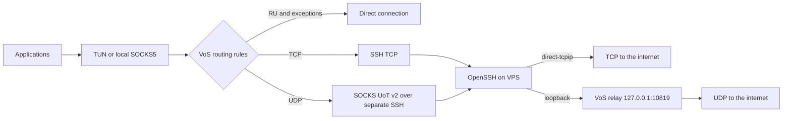

# VoS

VoS is an **experimental, headless SSH tunnel client** written in Go. It embeds
sing-box **1.14.3** and provides a CLI, a system TUN interface, a local SOCKS5
proxy, TCP and UDP transport over SSH, and split routing for Russian domains
and IP ranges.

**Status: alpha.** The CLI and local transport tests are available. System-wide
TUN capture, crash recovery, and network changes still need testing on real
macOS, Windows, and Linux hosts. There is no complete platform kill switch.
See [Architecture and roadmap](SPEC.md) for the current scope and planned work.



## Build

Use Go **1.26.9 or a newer supported release with current security fixes**.
The client does not need Python, a separate sing-box executable, or the `ssh`
command. Binaries embed the networking core and an offline routing snapshot.
The first build downloads dependencies pinned in `go.mod` and `go.sum`.

```bash
git clone https://github.com/kristallzero/vos.git
cd vos
bash scripts/build.sh                          # current platform
GOOS=linux GOARCH=amd64 bash scripts/build.sh   # typical VPS
GOOS=linux GOARCH=arm64 bash scripts/build.sh
GOOS=windows GOARCH=amd64 bash scripts/build.sh
GOOS=darwin GOARCH=arm64 bash scripts/build.sh
```

Output is written to `bin/`. The script enables `with_gvisor` and disables CGO.
To build directly in Windows PowerShell:

```powershell
$env:CGO_ENABLED="0"
go build -mod=readonly -trimpath -tags with_gvisor -o bin/vos.exe ./cmd/vos
```

The CLI can also be installed from source:

```bash
CGO_ENABLED=0 go install -tags with_gvisor github.com/kristallzero/vos/cmd/vos@latest
```

Use an explicit release tag instead of `@latest` when a pinned version is needed.
For binary redistribution, include the license and dependency notices described
in [THIRD_PARTY.md](THIRD_PARTY.md).

## Server

The installer targets Debian/Ubuntu with systemd. The server accepts SSH TCP;
the relay listens only on loopback. IP forwarding, external SOCKS/UDP ports,
and a server-side TUN interface are unnecessary. Supply **your prebuilt Linux
binary** to the installer with `--binary`.

Generate a dedicated client key. Keep the private key on the client:

```bash
ssh-keygen -t ed25519 -f ~/.ssh/vos -C vos-client
```

Copy `server/install.sh`, `bin/vos-linux-amd64`, and the generated public key
`~/.ssh/vos.pub` to the server. The examples below assume they are named
`install.sh`, `vos-linux-amd64`, and `vos.pub` in the server's current directory.

**If SSH already listens on port 443**, install only the relay:

```bash
sudo bash install.sh --binary ./vos-linux-amd64 --reuse-ssh --port 443
```

That SSH listener must allow `direct-tcpip` forwarding (`AllowTcpForwarding local`
or `yes`), including connections to `127.0.0.1:10819`. Use the account and client
key already configured for that listener.

**For a new server or an unused port**, install a dedicated listener:

```bash
sudo bash install.sh --binary ./vos-linux-amd64 \
  --user vos-user --create-user --public-key ./vos.pub --port 443
```

The administrative SSH service is preserved. Add `--open-firewall` to allow the
SSH port through an active UFW firewall; configure any provider firewall
separately. The installer refuses to replace an unrelated service on port 443.

The installer creates:

- `/usr/local/lib/vos/vos`: the relay executable;
- `/etc/vos/relay.json` and `vos-relay.service`: an unprivileged relay;
- in dedicated mode, `/etc/vos/sshd_config`, separate authorized keys, and
  `vos-sshd.service`, with no shell sessions, passwords, or remote forwarding;
- a `vos-relay` service account and, with `--create-user`, an SSH account.

For upgrades, repeat the same command with a new binary. On failure, managed
files and the original active/enabled state of affected services are restored.
Installed packages and newly created accounts are retained. `--reuse-ssh` does
not restart the existing SSH service or `vos-sshd`.

Server diagnostics:

```bash
sudo systemctl status vos-relay
sudo journalctl -u vos-relay -n 100 --no-pager
sudo systemctl status vos-sshd                 # dedicated mode only
sudo ss -ltnp
```

## Trust the server key

The installer prints the public Ed25519 host key and its fingerprint. Retrieve
`/etc/ssh/ssh_host_ed25519_key.pub` over a trusted administrative SSH connection
or provider console, and save it on the client as `server-host.pub`. If an
existing listener uses a different `HostKey`, retrieve its actual public key.
An unverified `ssh-keyscan` result alone does not establish trust.

The importer also accepts plain `known_hosts` entries with an exact hostname:
for port 443, use `[VPS_IP]:443`. Hashed entries, wildcards, and CA markers are
not supported by the current importer. A changed server key causes connections
to fail; verify the new key before explicitly adding it to `ssh.host_keys`.

SSH host key algorithms are selected from the pinned key types. With a single
trusted Ed25519 key, the client negotiates Ed25519 even when the server also
offers ECDSA or RSA. Pinned RSA keys use SHA-2 signatures.

## Client: proxy mode

These examples use macOS ARM64. Substitute the appropriate binary name on other
platforms. With `--reuse-ssh`, use the existing SSH account and identity.
Replace `VPS_IP` with your server's address.

```bash
./bin/vos-darwin-arm64 init --config config.json \
  --server VPS_IP --port 443 --user vos-user \
  --identity "$HOME/.ssh/vos" --host-key-file ./server-host.pub

./bin/vos-darwin-arm64 validate --config config.json
./bin/vos-darwin-arm64 run --config config.json
```

For an encrypted client key, set `VOS_KEY_PASSPHRASE` before `validate` or `run`.
It is not saved in JSON or included in `render` output. Configure a different
environment variable name with `ssh.passphrase_env`. `init` creates a file with
mode `0600` and refuses to overwrite an existing configuration. Keep profiles,
keys, and passphrases private; see [SECURITY.md](SECURITY.md).

In proxy mode, SOCKS5 listens on `127.0.0.1:10818`. Configure that proxy in the
applications you want to use. This mode does not change system routes or need
root. Applications must support UDP ASSOCIATE to use SOCKS UDP.

In a second terminal:

```bash
./bin/vos-darwin-arm64 probe
curl --socks5-hostname 127.0.0.1:10818 https://example.com
```

`probe` checks HTTP(S) and UDP DNS through SOCKS. To verify SSH transport,
choose destinations outside the direct routing rules. SOCKS DNS traffic is
handled as ordinary TCP/UDP; DNS interception is enabled for TUN. For hostnames
passed directly to SOCKS, the core applies its own DNS policy.

`Ctrl+C` or SIGTERM closes listeners and transports. An advisory lock prevents
concurrent runs of the same profile. A leftover `.lock` file does not mean the
profile is in use and can be left in place. After an SSH disconnect, new requests
reconnect; existing TCP sessions are not restored. SSH connections open lazily
on the first request, so `validate` checks configuration and keys, while `probe`
checks connectivity through a running client.

## Client: TUN mode

Copy the profile to `tun.json`, change `"mode": "proxy"` to `"mode": "tun"`, and
run with permission to create a virtual network interface:

```bash
sudo ./bin/vos-darwin-arm64 run --config ./tun.json
# Linux: sudo ./bin/vos-linux-amd64 run --config ./tun.json
```

On Windows, use an administrator terminal. TUN captures IPv4 **and** IPv6 with
the gVisor stack, automatic routes, strict routing, and native DNS with port 53
interception. Capturing IPv6 does not enable IPv6 internet access: the default
IP policy rejects it locally, as described below.
On normal shutdown, sing-box removes the routes and interface it created.
On macOS, VoS also installs a temporary system DNS resolver pointing to the
TUN DNS address (`172.31.255.2` with the default profile). The CLI's upstream
`dns_mode` alone does not set macOS system DNS, so a router resolver could
otherwise bypass TUN and return ISP block-page addresses. The resolver covers
all domains; VoS applies its configured direct/tunnel DNS policy to each query.
It lives in a separate `scutil` session and is removed when that session exits,
including when VoS dies and its stdin pipe closes. Existing Wi-Fi/Ethernet DNS
settings are retained. Failure to install the resolver aborts TUN startup.
After upgrading an already running client, restart VoS and the browser to
discard DNS answers cached before the fix.
Linux native DNS depends on systemd-resolved. Without it, set system DNS to the
virtual address `172.31.255.2` and retain the original settings for restoration.
A complete platform kill switch is not implemented.

The client classifies gVisor's TCP shutdown `endpoint not connected` as an
expected closed connection, logged at `trace` rather than `error`. This applies
only to TUN half-close operations; dialing, reads, writes, and other shutdown
errors retain their usual handling.

SSH forwarding preserves TCP half-close: an application can finish sending and
still receive the destination's response. The SSH stream is released on full
close, after both directions finish.

Set `ssh.interface` to a physical interface such as `en0` or `eth0` if needed.
It is used for outbound SSH, direct sockets, and bootstrap DNS to avoid routing
back into TUN. Without an explicit interface, TUN automatically detects the
physical network. Do not select the interface of another VPN.

The Linux container smoke test covers real TUN creation, IPv4/IPv6 addresses,
automatic routes, and cleanup on SIGTERM. Full system traffic capture on real
macOS, Windows, and Linux hosts needs separate privileged testing. Forced
termination, network changes, sleep/wake, and DNS recovery after crashes remain
roadmap items. Use proxy mode if you need to avoid experimental system changes.

## IP families

The top-level `"ip_mode": "ipv4_only"` is the default, including for existing
profiles that omit this field. It supports VPS hosts without IPv6 internet
access. Restart the client after upgrading; no relay upgrade is required.

In this mode:

- Core DNS answers AAAA queries with `NOERROR` and no records, without querying
  an upstream resolver. A records continue to follow the direct/tunnel policy.
- HTTPS DNS records retain IPv4 hints and have IPv6 hints removed. Hostnames
  supplied to SOCKS and SSH bootstrap DNS also use IPv4 resolution.
- TUN keeps its IPv6 address and routes so captured IPv6 cannot bypass the
  policy. Ordinary IPv6 flows are rejected before sniffing or route exceptions,
  using TCP reset or ICMP unreachable rather than silent packet drops. Repeated
  attempts keep receiving a rejection, allowing applications with IPv4 support
  to fall back without waiting for an IPv6 connection timeout.
- DNS sent to an IPv6 resolver on port 53 is intercepted locally and handled
  by the same IPv4 DNS policy. SOCKS IPv6 destinations are rejected as well.

Applications using their own DoH or cached IPv6 addresses can still try IPv6;
those connections are rejected. IPv6-only destinations cannot be reached in
this mode. SOCKS DNS packets remain ordinary proxy traffic, so their DNS answers
are not filtered by the core DNS policy.

To restore IPv6 forwarding, set `"ip_mode": "dual_stack"` and restart. This
retains IPv4 preference but allows AAAA answers and IPv6 connections under the
usual route rules. Enable it only when the VPS has working IPv6 egress and the
local network supports any configured direct IPv6 destinations.

## Russian services and routing exceptions

By default, private networks, Russian domains, and RU IPv4 ranges connect
directly; RU IPv6 ranges also bypass in `dual_stack` mode. The snapshot combines
MetaCubeX `geoip/ru` and `geosite/category-ru`
with the supplementary suffixes in `core/assets/manual-domains.json`, including
`.ru`, `.su`, and `.xn--p1ai`. Sources, snapshot date, and SHA256 hashes of the
upstream documents are recorded in `core/assets/rules.json`.

The `routes` section supports:

```json
{
  "bypass_private": true,
  "bypass_ru": true,
  "force_tunnel_domains": ["example.ru"],
  "force_tunnel_ips": ["203.0.113.0/24"],
  "force_direct_domains": ["my-service.example"],
  "force_direct_ips": ["198.51.100.0/24"],
  "rule_file": "rules.json"
}
```

Domains are suffixes without `domain:` prefixes or URLs; use punycode for IDNs.
Force-tunnel rules take precedence over force-direct rules and automatic
RU/private bypass. The core identifies the domain, resolves it using the DNS
policy, then evaluates domain and IP rules. Russian and force-direct domains
use direct DNS (`77.88.8.8` over UDP by default); other domains resolve through
SSH (`1.1.1.1` over TCP by default). Bootstrap DNS for the VPS itself is direct.
IP exceptions apply after resolution and do not change a domain's DNS query.

A `using outbound/direct[direct] ... i/o timeout` means that the destination
did not answer a direct connection attempt. With RU bypass enabled, Russian
IP addresses also go direct when the application connects to an IP literal.
To try one affected destination through SSH, add its `/32` prefix (or `/128`
for IPv6 in dual-stack mode) to `force_tunnel_ips` and restart. A timeout alone
does not establish that the destination will be reachable from the VPS.

Update the lists explicitly:

```bash
./bin/vos-darwin-arm64 rules update --output ./rules.json
```

Set `routes.rule_file` to that file, validate the profile, and restart the client.
An empty value uses the embedded snapshot. Updates require HTTPS, check schema
and size, and replace both datasets together with one atomic rename. Failed
updates retain the previous file. Running clients do not reload rules.

Shared CDNs, application-specific DoH, and ECH can hide domains, so automatic
recognition of all Russian services cannot be guaranteed. Add exceptions when
needed. UDP over SSH inherits TCP loss and latency behavior; calls and games
need testing on the actual network. ICMP is unsupported.

## Development and verification

```bash
go test -race -tags with_gvisor ./...
go vet -tags with_gvisor ./...
go mod verify
go run golang.org/x/vuln/cmd/govulncheck@v1.8.0 -tags with_gvisor ./...
bash -n server/install.sh scripts/build.sh tests/server/test.sh tests/server/tun-smoke.sh
```

GitHub Actions runs Go tests on Linux, macOS, and Windows, scans for known
vulnerabilities, cross-compiles supported desktop/server targets, and checks
the installer and Linux TUN lifecycle inside isolated containers. These checks
run after pushing; they do not establish coverage of real systemd boot or
host-wide TUN behavior.

For a local Debian installer check on an ARM64 Docker host:

```bash
GOOS=linux GOARCH=arm64 bash scripts/build.sh
docker build -f tests/server/Dockerfile -t vos-installer-test:local .
docker run --rm --network none --cap-add SYS_PTRACE vos-installer-test:local

# Optional TUN creation and cleanup inside the container only:
docker run --rm --network none --cap-add SYS_PTRACE --cap-add NET_ADMIN \
  --device /dev/net/tun --sysctl net.ipv6.conf.all.disable_ipv6=0 \
  --sysctl net.ipv6.conf.default.disable_ipv6=0 \
  vos-installer-test:local bash /tun-smoke.sh
```

For an x86 Docker host, build with `GOARCH=amd64` instead. The Dockerfile selects
the binary for the container architecture. Running containers need no external
network. `SYS_PTRACE` allows `ss` to identify the unprivileged relay process.

Go tests generate their own keys and run a real in-process SSH server to check
TCP/UDP, host key pinning, reconnects, DNS, route overrides, and locking. The
TCP tests also verify responses after upload EOF on direct and SSH routes,
connection cleanup, and classification of expected TUN shutdown errors.
macOS DNS tests cover resolver address selection and subprocess lifetime,
including rejected writes, startup cancellation, and EOF cleanup, without
changing the host's DNS settings. The
IP-policy tests exercise the TUN flow verdicts for TCP/UDP/ICMPv6, rejection
bursts, SOCKS IPv6 rejection without SSH forwarding, intercepted AAAA/A/HTTPS
DNS responses, legacy-profile defaults, and explicit dual-stack opt-in. They
do not create a privileged host TUN interface. The installer container uses
real OpenSSH and the VoS relay, but emulates service
lifecycle with a test `systemctl`. It exercises install, upgrade, rollback,
loopback binding, SSH settings, and reuse. Real systemd startup and service
sandboxing still require a VPS or VM.

```text
SPEC.md                    Architecture, scope, and roadmap
core/                      Shared Go library, config, DNS, routing, transport
core/assets/               Offline routing snapshot
internal/sshtransport/     SSH adapter with TCP half-close forwarding
internal/macosdns/         Temporary macOS system DNS resolver
cmd/vos/                   CLI
server/install.sh          VPS installer
scripts/build.sh           Builds without CGO
scripts/collect-licenses.go Dependency notice generator
.github/workflows/         Continuous integration
tests/server/             Isolated installer integration tests
```

See [CONTRIBUTING.md](CONTRIBUTING.md) for development guidelines and
[SECURITY.md](SECURITY.md) for security reports and operational limitations.

## License

Copyright (C) 2026 VoS contributors.

VoS is free software licensed under **GNU GPL version 3 or, at your option,
any later version** (`GPL-3.0-or-later`), without warranty. See [LICENSE](LICENSE)
for the full terms and [THIRD_PARTY.md](THIRD_PARTY.md) for dependency and routing
data notices.
